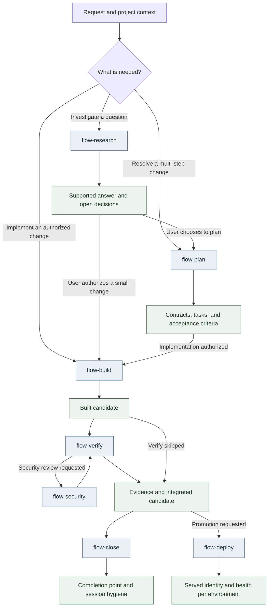

<div align="center">


<p><strong>Portable guidance for deliberate work with coding agents.</strong></p>
<p>Clarify the request. Preserve the project. Verify the result.</p>

<p>
<a href="https://hive.tricell.tech/">Docs</a> ·
<a href="#get-started">Get started</a> ·
<a href="#a-workflow-with-room-for-judgment">Workflow</a> ·
<a href="#hosts">Hosts</a> ·
<a href="#for-ai-agents">For AI agents</a> ·
<a href="#documentation">Documentation</a>
</p>

</div>

Hive brings shared working practices to **Claude Code, Codex, Grok Build, Pi,
OpenCode V2, and Cursor CLI**. It supplies guidance, activity skills, specialist
role definitions, and a manager that installs them in the host's native locations.
Each CLI keeps its own model loop, authentication, tools, permissions, and history.

The global core keeps essential boundaries and points to canonical skill
references before the action that needs them. Reporting applies to findings,
explanations and messages with external links or IDs; greetings and short direct
answers need no reference read. Questions, delegation, artifact details and project
settings have explicit read conditions. Installing a reference makes it available, not necessarily read
or followed. This organization does not establish reliability for any model family.

OpenCode V2 also receives an **optional, inactive context loader** at user scope in
`<OpenCodeHome>/hive/context-loader/{index.js,context-loader.json}`, outside
auto-discovered `plugins/`, with no `package.json`.
When explicitly activated, it supplies a generated snapshot of the fixed reference
for `hive-review-plan` and `hive-review-harness`, not other roles or main-thread
questions. It reads no reference files or metadata during requests. Updating the
snapshot requires manager regeneration and plugin reload; editing an installed
Markdown file alone does not refresh it. Activate only the installed `hive/context-loader` directory, not the repository's editorial template. It changes
neither permissions nor models and does not enforce behavior. Manual activation,
deactivation and removal prerequisites are in the
[loader contract](_support/docs/architecture/deployment-manager.md#optional-opencode-context-loader).
New offline packages use manifest version 2 and require the accompanying manager;
older managers that accept only version 1 cannot verify them.

Use it to investigate an uncertain request, plan a consequential change, or carry
an understood task through implementation and verification—with clear boundaries
between what was requested, what was authorized, and what was demonstrated.

> **Version 0.6.0 · verify, deploy and security stages, consistent workflow rules, and an up-to-date site**
> Each release sets [VERSION](VERSION) to its product version; between releases,
> `development` carries `dev`. Packages for macOS Apple
> Silicon and Linux arm64/amd64 are published on
> [GitHub Releases](https://github.com/JhonHawk/tricell-hive/releases). See the
> [changelog](CHANGELOG.md) for what this release contains.

## Why Hive

- **Start at the right depth.** A question can end with an answer. A small,
  understood change can go straight to implementation. Larger work gets explicit
  contracts, decisions, and acceptance criteria.
- **Make handoffs useful.** Specialist roles receive a bounded task, owned paths,
  relevant context, and evidence to return. Implementation, review, and
  verification have separate responsibilities.
- **Keep decisions connected to evidence.** Requirements and change records
  preserve context; findings distinguish observed results from assumptions and
  unfinished work.
- **Manage guidance without replacing the host.** Installation previews affected
  destinations, checks ownership and drift, preserves user content outside managed
  resources, and supports diagnosis and recovery.

## Get started

Install your coding CLI separately first; Hive neither installs CLI executables
nor authenticates providers. Close affected CLI sessions before installing and
start new ones afterward. The one-line installation is the recommended route;
the release package and the source checkout are alternatives.

### One-line installation (recommended)

On **macOS Apple Silicon** or **Linux (arm64/amd64)**, in a terminal:

```sh
curl -fsSL https://hive.tricell.tech/install.sh | sh
```

It asks which hosts to install and confirms before it writes.

- **Preview first:** append `-s -- --dry-run`. No host changes; the package is
  still downloaded.
- **Pick a release or hosts:** append `-s -- --version 0.6.0 --hosts claude,codex`.
- **Afterwards:** `hive` is not added to your `PATH`. It lives at
  `~/.local/share/hive/packages/hive-<version>-<os>-<arch>/bin/hive`.
- **Requirements:** `curl`, `tar`, and `shasum` or `sha256sum`.

The [installer contract](_support/docs/architecture/installer.md#one-line-installation)
lists what the script checks.

### From a release package

Packages are built for **macOS Apple Silicon (arm64)** and **Linux arm64 and
amd64**. macOS Intel is unsupported. To install by hand, download
`hive-<version>-<os>-<arch>.tar.gz` and its `.sha256` file from the
[GitHub Releases page](https://github.com/JhonHawk/tricell-hive/releases), then
verify, extract, preview, and install:

```sh
shasum -a 256 -c hive-<version>-<os>-<arch>.tar.gz.sha256   # or: sha256sum -c
tar -xzf hive-<version>-<os>-<arch>.tar.gz
cd hive-<version>-<os>-<arch>
./install.sh --dry-run
./install.sh
```

`install.sh` asks which hosts to install and confirms before it writes. It does
not put `hive` on your `PATH`: run later commands with the extracted `bin/hive`
(for example `./bin/hive status ...`), or copy that file to a directory on your
`PATH`.

On macOS, Gatekeeper may block a binary downloaded through a browser (a
possibility, not verified here). Either download with `curl` or `gh release
download`, or clear the quarantine flag on the extracted files:

```sh
xattr -dr com.apple.quarantine hive-<version>-<os>-<arch>
```

The core installs offline and needs no Go, Git, or GitHub CLI. Two network
steps are optional: selecting the Pi host may run
`pi install npm:pi-subagents`, which downloads that package from npm, and
consenting to `agent-browser` downloads it and, when no browser is found,
Chrome for Testing.
GitHub's automatic **Source code** archives are not packages; use the
`hive-<version>-…` assets.

### From a source checkout

From the checkout root, with **Go 1.27.0 or later** as declared in [go.mod](go.mod):

```sh
# Preview the destinations, then install with terminal confirmation.
go run ./tooling/cli install --hosts codex --dry-run
go run ./tooling/cli install --hosts codex
```

Replace `codex` with your host, or a comma-separated selection such as
`codex,claude`. The installer shows destinations and private backup locations
before requiring affirmative confirmation. The first build needs access to the
Go modules unless they are already cached.

<details>
<summary><strong>Package building and optional capabilities</strong></summary>

Maintainers can build packages locally with `go run ./tooling/package --out ./dist`.
Building does not publish a release.

Engram, Context7 and CodeGraph are optional, separately managed capabilities with official
manual instructions and no automated provider recipes or credential requests;
CodeGraph's own `codegraph install` wires its MCP server into your hosts.
Four steps are automated: pi-subagents, which a user-scope Pi installation adds
with `pi install` when Pi does not already declare it; `agent-browser`, which
an interactive install offers on macOS arm64 (Homebrew) and Linux amd64 (Node
24+) and installs, at its latest version, only after you consent to the commands
it shows; and the Codex question card (`codex-question-card`), which an
interactive install with the Codex host offers selected by default when the
installed Codex supports it (0.163.0 or later) and, after you consent, enables with `codex features enable
default_mode_request_user_input`, Codex's own command, so Codex asks its
decisions through a card that waits in Default mode (uncheck it, or type `none`,
to skip it; `codex features disable default_mode_request_user_input` turns it
off). The Codex wait floor (`codex-wait-floor`) is the fourth: an interactive
install or `hive update` with the Codex host offers it, selected by default, while
the setting is not applied and Codex is 0.164 or later (a dry run offers
nothing, an applied setting is not offered again, and nothing is offered at project scope). After you consent, Hive
itself writes `min_wait_timeout_ms = 300000` and
`default_wait_timeout_ms = 600000` under `[features.multi_agent_v2]` in Codex's
`config.toml`, so a parent agent waiting for a delegated child does not wake
every 60 seconds. When `config.toml` exists it saves `config.toml.hive-backup`
(mode 0600) next to it before the first write, and a missing file is created
with mode 0600; its journal keeps only fingerprints and the
lines it added. `hive plan remove` for the codex host removes only the lines
Hive wrote that still have their values, then the backup after a clean revert;
if Codex's file is one Hive cannot edit safely, the offer becomes a manual step
instead. The minimum applies to Codex's v2 multi-agent runtime; v1 is not
verified. An older Hive binary that rewrites Hive's state loses the record of
the write, and then `plan remove` leaves the lines in place. The wait floor is
the only step where Hive writes a host configuration file itself; pi-subagents
and the question card run the host's own command, and `agent-browser` runs
Homebrew or npm. Selecting a manual capability leaves the installed core intact but returns a non-zero exit status
to signal unfinished setup.
`hive setup` reports local discovery without installing tools; discovery does not
establish authentication, service access, or host loading.

See the [installer contract](_support/docs/architecture/installer.md) for package
checks, legacy migration, and interrupted-install recovery, and
[optional tool dependencies](_support/docs/architecture/tool-dependencies.md)
for capability requirements.

</details>

## Hosts

Six host adapters are implemented. Their presence and installation on disk do
not prove that a particular session loaded the content or followed it.

| Host | Scope | Requirements and limits |
| --- | --- | --- |
| Claude Code | User and project | Native instructions, skills, and rendered roles. A project's `CLAUDE.md` must import `@AGENTS.md`. |
| Codex | User and project | Native instructions, shared skills, and rendered roles. |
| Grok Build | User | Claude instruction compatibility must be enabled, or the install reports a conflict. Role selection varies by version. Hive adds a `read_file` hook, `~/.grok/hooks/hive-read-whole-references.json`, so skill references are read whole; it runs the `hive` binary that installed it, so restart Grok sessions after installing. |
| Pi | User | Delegated roles need pi-subagents (installed through npm as described above). Honors `PI_CODING_AGENT_DIR`. |
| OpenCode V2 | User | Needs your own model providers; the default role profiles assume OpenCode Go models, so set others with `hive models set`. |
| Cursor CLI | User | Loads no global instruction file; each repository needs a pointer line (below). User-level role selection remains unverified. |

Only Claude Code and Codex support `--scope project`; the other four reject it.
Project scope writes inside one repository:

```sh
./bin/hive plan install --hosts codex,claude --scope project --root /absolute/project --out /absolute/plan.json
./bin/hive apply --plan /absolute/plan.json
```

**Shared resources.** Hosts that share one file, such as the skills under
`~/.agents/skills`, are registered as consumers of it. Updating shared bytes
requires selecting every registered consumer, so installing one host may require
selecting others. Removing one host keeps a shared file until its last consumer
is removed.

**Grok and Cursor together.** Grok loads Hive's guidance from
`~/.claude/CLAUDE.md` and again from `~/.cursor/AGENTS.md`, about 10,700 tokens
per session. The installer warns about it; setting `agents = false` under
`[compat.cursor]` in Grok's `config.toml` removes the copy, at the cost that your
own text in `~/.cursor/AGENTS.md` stops loading in Grok.

**Cursor pointer.** Cursor CLI does not read `~/.cursor/AGENTS.md` on its own. Add
this line to each repository's `AGENTS.md` where you use Cursor, near the top and
outside its `## Hive` section:

```markdown
Cursor sessions: unless your loaded instructions contain the line "# Tricell Hive guidance" as a heading of its own, read `~/.cursor/AGENTS.md` before any other action and follow it. If that file is missing, say so and continue.
```

See [native destinations](_support/docs/architecture/deployment-manager.md#content-and-native-destinations)
and [agent delivery](_support/docs/architecture/agent-delivery.md) for documented
versions and observations. [Role profiles](integrations/agent-profiles.json)
configure model and effort defaults; account access, effective child models,
native permissions, and parent overrides still need to be checked in context.
Hive supplies no model runtime or universal permission sandbox.

## Update, verify, recover, and uninstall

The commands below call `hive`. After a one-line installation it is
`~/.local/share/hive/packages/hive-<version>-<os>-<arch>/bin/hive`; after a
package installation, the extracted `bin/hive`; in a source checkout, use
`go run ./tooling/cli`. Copy or link it into a directory on your `PATH` to type
`hive` directly.

**Update.** One-line users run the same command again; each version adds its
own folder under `~/.local/share/hive/packages/`, and older ones can be deleted
once you no longer need them for recovery and Grok's hook no longer points to
them: run `hive update` or `hive install` from the newer binary first. Package users run the
newer package's `./install.sh`. Source users
pull, rebuild the binary when `tooling/` or `integrations/` changed, then preview
and apply. `hive update` deploys the committed `HEAD`, never uncommitted edits,
and does not replace the binary:

```sh
git pull
go build -o ~/bin/hive ./tooling/cli   # if tooling/ or integrations/ changed; use your hive path
hive update --dry-run
hive update
```

**Verify.** `status` checks managed files, `doctor` reports CLI and installation
diagnostics, and `models` reports effective role configuration. Installed files,
discovered roles, and a successful model task are different kinds of evidence.

```sh
hive status --hosts codex --scope user
hive doctor
hive models
```

**Releases.** `hive releases` lists the release snapshots Hive keeps.

**Recover.** An interrupted operation blocks further plans until recovery runs:

```sh
hive recover [--state-dir DIR]
```

**Uninstall.** Write a removal plan, review it, then apply it. Without `--out`,
`plan remove` only prints the plan:

```sh
hive plan remove --hosts <hosts> --scope user --out <plan.json>
hive apply --plan <plan.json>
```

Only the managed instruction block and files Hive created are removed; your
other content stays. In the full-screen interface (`hive`, or `hive tui`), `u` in
the CLIs view opens **Uninstall all**, which removes every registered host after a
confirmation that starts on Cancel. The
[manager contract](_support/docs/architecture/deployment-manager.md) documents
project scope, saved plans, removal, and recovery; the
[update reference](_support/docs/architecture/deployment-manager.md#update-from-a-commit-and-list-releases)
covers exact revision selection.

## A workflow with room for judgment

Start where the request belongs. These are available routes, not a mandatory
sequence for every task. Authorization and preservation apply throughout.



- [Research](https://hive.tricell.tech/flows/research/) ([skill](content/skills/flow-research/SKILL.md)) turns uncertainty into a supported
  answer. It can stand alone and does not authorize implementation.
- [Plan](https://hive.tricell.tech/flows/plan/) ([skill](content/skills/flow-plan/SKILL.md)) resolves consequential decisions and
  defines contracts, verifiable tasks, and acceptance criteria when needed.
- [Build](https://hive.tricell.tech/flows/build/) ([skill](content/skills/flow-build/SKILL.md)) reconciles current state and
  implements authorized work. It ends at a built candidate and hands it to Verify.
- [Verify](https://hive.tricell.tech/flows/verify/) ([skill](content/skills/flow-verify/SKILL.md)) checks the candidate at a level
  the project's settings and your request set: affected tests, runtime and UI
  checks, the full suite and the dedicated review, and then integrates it.
- [Security](https://hive.tricell.tech/flows/security/) ([skill](content/skills/flow-security/SKILL.md)) runs an independent
  security review only when you ask for it, inside Verify or on a merged commit,
  and reports findings without fixing them.
- [Close](https://hive.tricell.tech/flows/close/) ([skill](content/skills/flow-close/SKILL.md)) reconciles the completion record and
  cleans up task-owned temporary resources while preserving unfinished work. It
  runs at integration, also when a project declares a later completion point in
  its `Completion` key.
- [Deploy](https://hive.tricell.tech/flows/deploy/) ([skill](content/skills/flow-deploy/SKILL.md)) is a separate stage after
  integration: it promotes through the declared environments and checks what is
  served. It never holds a close open: when a project declares a later
  completion point in its `Completion` key, Deploy moves the ticket to its final
  state once the condition holds.

The [shared guidance](content/guidance/global.md) owns the detailed authorization,
preservation, evidence, and artifact rules. Local edits, commits, publication,
merges, and deployments are distinct effects; a plan or skill selection does not
provide authorization for them.

## Work in your project

Keep project context and repository settings in `AGENTS.md`: project identity,
base branch, tracker, and the versioned requirements directory. Follow your CLI's
native instruction and skill discovery mechanism.
[Hive's repository guidance](AGENTS.md) is an example for this project, not a file
to copy unchanged into another one.

Two commands tune the setup from a terminal:

- `hive project set` edits the `## Hive` section of the repository's `AGENTS.md`
  after confirmation, with `--set 'Key: value'` and `--unset Key` (and
  `--dry-run` to preview). The section holds facts only; the delivery mode, the
  review mechanism and the `UI verification` level are asked each session, and
  `hive doctor` warns about leftover `Review`, `UI verification` or
  `Delivery: automatic|interactive` lines. `hive doctor` exits non-zero when the
  `## Hive` section has a blocking finding, and `harness-audit` can create or
  update the section for you.
- `hive voice` lists the voices (`hive voice list`), selects one with `hive voice set ID`,
  and turns it off with `hive voice off`.

Give the agent an outcome and clear boundaries:

```text
Investigate why this endpoint times out. Read only; report evidence and options.
Plan the API change, including compatibility and acceptance checks.
Implement the agreed change locally and verify it. Do not commit or publish.
Close this work item and clean up only the temporary resources it created.
```

### Review UI walkthroughs in one place

When an agent validates a user interface with you, it writes the walkthrough as
`walkthrough.json` in the `_support/workspace/` of the repository, or of the
multi-repository workspace folder that holds it. With the Hive binary installed,
the viewer renders that JSON; a standalone HTML page is generated only without
the binary. An already generated page is preserved when the mode changes. To keep those walkthroughs after the session and browse them by
project and session, with ticket details on each segment, run the local viewer yourself:

```sh
hive view register --dir <folder>   # once per repository or workspace; agents run it too
hive view start      # a server on 127.0.0.1 that keeps running until you stop it
hive view open       # open it in the browser
hive view stop
```

The viewer uses React with public MIT shadcn/ui and ReUI components in a custom
shell; it needs no Node, ReUI license or third-party network connection to run.
Frontend development and bundle checks are described in
[Contributing](CONTRIBUTING.md#viewer-frontend).

The viewer copies eligible walkthroughs into Hive's state directory, deletes copies
older than 14 days unless you pin them (`--ttl` changes that), and lets you
delete one from its segment toolbar; it never changes files in your repositories.
Archive hides a stored copy from the default list, and Restore brings it back.
The icon beside Projects shows or hides archived copies. Archiving is independent
of pinning, the 14-day retention period and work status; pin a copy to keep it
beyond that period. Projects show session counts and open initially only when
they contain work in progress. Your project expansion, sidebar visibility,
archive filter and selection survive refresh in the same browser tab. Walkthroughs
with the same project, host and declared session ID share one sidebar entry, even
across tickets. Their segments appear chronologically with internal separators,
individual controls and ticket search links. The session header collects explicit
PR/commit delivery links, and each segment retains its own links; missing metadata
is shown as unregistered delivery rather than inferred from the candidate commit.
Manifests confirmed as tracked in Git are not imported. Previously imported copies
whose source is now tracked appear separately with an explanation, without rendering
the walkthrough; their pins and normal retention still apply. If the source cannot
be classified, the viewer shows an unknown-origin warning. A local file does not
prove agent authorship. Ingestion rejects hard-linked manifests and referenced files.
`hive view open` passes a one-use opening code, valid for 60 seconds, in the URL
fragment. The page removes it before exchanging it for the server token and reads
no walkthroughs until access succeeds. If opening fails, run the command again. `register` takes the folder that contains `_support/workspace/` when
`--dir` points inside it, even if that folder is not a Git repository (a
multi-repository workspace), and the Git root otherwise. Agents never start it.

Each segment's informational status indicator shows explicit work status:
In progress, Closed, or Not reported
(`unknown`) for historical manifests without it. This is independent of source
classification. Closed means the work passed through `flow-close`, including a
pause or abandonment; it does not mean UI approval or that the host conversation
ended. The [walkthrough close procedure](content/skills/flow-close/references/walkthrough-close.md)
confirms the current closed copy before eligible source cleanup.

When updating from a viewer that predates session status or delivery links, update the binary and
installed content together and coordinate stopping and starting the existing
viewer before using the new producers. Rebuilding the binary does not update a
running process. Older strict viewers reject the new manifest fields; an unconfirmed
closure preserves its source evidence.

## For AI agents

Hive is a guidance layer plus a manager: shared rules, activity skills, and
specialist role definitions that the manager installs into each coding CLI's
native locations. The files an agent should read first are in
[llms.txt](llms.txt).

- `content/` is distributable: shared guidance, activity skills, canonical roles,
  and voices.
- `integrations/` is distributable: per-host destinations and role profiles.
- `tooling/` is the Go manager, distribution logic, and package builder.
- `_support/` is internal maintainer material: architecture docs, research, and
  change records under `_support/openspec/`. It is not installed.
- `tests/` holds content checks, fixtures, and evaluation tooling. It is not
  installed.
- `site/` is the source of the documentation site for people. It is
  not installed.
- The root [AGENTS.md](AGENTS.md) is maintainer guidance for this repository, not
  guidance to copy into another project.

## Documentation

- [Documentation site](https://hive.tricell.tech/) — getting started, skills and
  flow guides, release history, and the projects that inspire Hive.
- [Changelog](CHANGELOG.md), [contributing](CONTRIBUTING.md), and
  [security policy](SECURITY.md).
- [Architecture](_support/docs/architecture/repository-and-distribution.md) —
  structure, ownership, managed instruction blocks, and preservation.
- [Requirements and changes](_support/openspec/) — versioned requirements and
  retained change records.
- [Harness engineering research](_support/docs/harness-engineering/README.md) —
  research sources and the measurement standard.
- [content/](content/) — canonical guidance, skills, specialist roles, and voices.
- [integrations/](integrations/) — native host destinations and role profiles.
- [tooling/](tooling/) — Go manager, distribution logic, and package builder.
- [tests/](tests/) — content checks, fixtures, and evaluation tooling.

For manager development, run `go vet ./...` and `go test ./...`; concurrency
changes also require `go test -race ./...`. The
[verification contract](_support/docs/architecture/deployment-manager.md#verification)
explains additional checks and their limits. Model behavior pilots remain paused.
Ordinary source and installation tests do not establish model compliance or a
measured improvement in speed, quality, or reliability.

## History and provenance

The preserved history records delegation and separate verification in June 2026,
expanded external research in August, and dedicated research procedures, critical
synthesis, and specialist research roles in September. The
[history and technical provenance](_support/docs/history/history-and-provenance.md)
documents the five milestones, curated commit mappings, attribution, and the
limits of Git dates and external corroboration. These records describe Hive's
evolution; they do not establish invention, priority, or independence from other
projects. Historical implementations are context, not current installation instructions.
