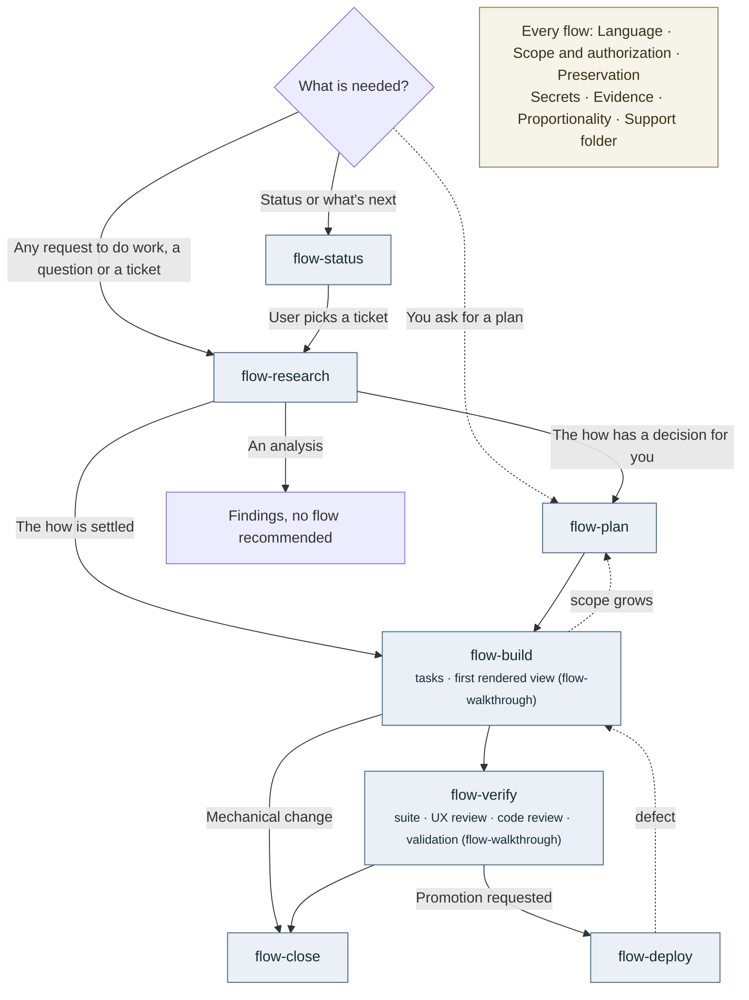

<div align="center">


<p><strong>Portable guidance for deliberate work with coding agents.</strong></p>
<p>Clarify the request. Preserve the project. Verify the result.</p>

<p>
<a href="https://hive.tricell.tech/">Docs</a> ·
<a href="#get-started">Get started</a> ·
<a href="#a-workflow-with-room-for-judgment">Workflow</a> ·
<a href="#hosts">Hosts</a> ·
<a href="#for-ai-agents">For AI agents</a> ·
<a href="#documentation">Documentation</a>
</p>

</div>

Hive brings shared working practices to **Claude Code, Codex, Grok Build, Pi,
OpenCode V2, Cursor CLI, and Antigravity**. It supplies guidance, activity skills, specialist
role definitions, and a manager that installs them in the host's native locations.
Each CLI keeps its own model loop, authentication, tools, permissions, and history.

The global core keeps essential boundaries and points to canonical skill
references before the action that needs them. Reporting applies to findings,
explanations and messages with external links or IDs; greetings and short direct
answers need no reference read. Questions, delegation, artifact details and project
settings have explicit read conditions. Installing a reference makes it available, not necessarily read
or followed. This organization does not establish reliability for any model family.

OpenCode V2 also receives an **optional, inactive context loader** at user scope in
`<OpenCodeHome>/hive/context-loader/{index.js,context-loader.json}`, outside
auto-discovered `plugins/`, with no `package.json`.
When explicitly activated, it supplies a generated snapshot of the fixed reference
for `hive-review-plan` and `hive-review-harness`, not other roles or main-thread
questions. It reads no reference files or metadata during requests. Updating the
snapshot requires manager regeneration and plugin reload; editing an installed
Markdown file alone does not refresh it. Activate only the installed `hive/context-loader` directory, not the repository's editorial template. It changes
neither permissions nor models and does not enforce behavior. Manual activation,
deactivation and removal prerequisites are in the
[loader contract](_support/docs/architecture/deployment-manager.md#optional-opencode-context-loader).
New offline packages use manifest version 2 and require the accompanying manager;
older managers that accept only version 1 cannot verify them.

Use it to investigate an uncertain request, plan a consequential change, or carry
an understood task through implementation and verification—with clear boundaries
between what was requested, what was authorized, and what was demonstrated.

> **Version 0.9.0 · complete release updates, stable command migration, and recoverable offline plans**
> Each release sets [VERSION](VERSION) to its product version; between releases,
> `development` carries `dev`. Packages for macOS Apple
> Silicon and Linux arm64/amd64 are published on
> [GitHub Releases](https://github.com/JhonHawk/tricell-hive/releases). See the
> [changelog](CHANGELOG.md) for what this release contains.

## Why Hive

- **Start at the right depth.** A question can end with an answer. A small,
  understood change can go straight to implementation. Larger work gets explicit
  contracts, decisions, and acceptance criteria.
- **Make handoffs useful.** Specialist roles receive a bounded task, owned paths,
  relevant context, and evidence to return. Implementation, review, and
  verification have separate responsibilities.
- **Keep decisions connected to evidence.** Requirements and change records
  preserve context; findings distinguish observed results from assumptions and
  unfinished work.
- **Manage guidance without replacing the host.** Installation previews affected
  destinations, checks ownership and drift, preserves user content outside managed
  resources, and supports diagnosis and recovery.

## Get started

Install your coding CLI separately first; Hive neither installs CLI executables
nor authenticates providers. Close affected CLI sessions before installing and
start new ones afterward. The one-line installation is the recommended route;
the release package and the source checkout are alternatives.

### One-line installation (recommended)

On **macOS Apple Silicon** or **Linux (arm64/amd64)**, in a terminal:

```sh
curl -fsSL https://hive.tricell.tech/install.sh | sh
```

It asks which hosts to install and confirms before it writes.

- **Preview first:** append `-s -- --dry-run`. No host changes; the package is
  still downloaded; behavior depends on the selected package version.
- **Pick a release or hosts:** append `-s -- --version 0.9.0 --hosts claude,codex`.
- **Afterwards:** packages with the new update protocol register
  `~/.local/bin/hive` as the stable command. The installer does not edit `PATH`
  or overwrite an unowned file there. Older packages print their versioned path.
- **Requirements:** `curl`, `tar`, and `shasum` or `sha256sum`. Some skills
  also run bundled scripts with `python3` (3.7 or later), such as the change
  folder checks and the Git-state and task-progress helpers; the last two fall
  back to the commands they replace when `python3` is missing.

The [installer contract](_support/docs/architecture/installer.md#one-line-installation)
lists what the script checks.

### From a release package

Packages are built for **macOS Apple Silicon (arm64)** and **Linux arm64 and
amd64**. macOS Intel is unsupported. To install by hand, download
`hive-<version>-<os>-<arch>.tar.gz` and its `.sha256` file from the
[GitHub Releases page](https://github.com/JhonHawk/tricell-hive/releases), then
verify, extract, preview, and install:

```sh
shasum -a 256 -c hive-<version>-<os>-<arch>.tar.gz.sha256   # or: sha256sum -c
tar -xzf hive-<version>-<os>-<arch>.tar.gz
cd hive-<version>-<os>-<arch>
./install.sh --dry-run
./install.sh
```

`install.sh` asks which hosts to install and confirms before it writes. It does
not edit `PATH`. A package with the new update protocol retains its verified
package and registers `~/.local/bin/hive`; an unowned destination is a conflict.
Older packages use the extracted `bin/hive`.

On macOS, Gatekeeper may block a binary downloaded through a browser (a
possibility, not verified here). Either download with `curl` or `gh release
download`, or clear the quarantine flag on the extracted files:

```sh
xattr -dr com.apple.quarantine hive-<version>-<os>-<arch>
```

The core installs offline and needs no Go, Git, or GitHub CLI. Two network
steps are optional: selecting the Pi host may run
`pi install npm:pi-subagents`, which downloads that package from npm, and
consenting to `agent-browser` downloads it and, when no browser is found,
Chrome for Testing.
GitHub's automatic **Source code** archives are not packages; use the
`hive-<version>-…` assets.

### From a source checkout

From the checkout root, with **Go 1.27.0 or later** as declared in [go.mod](go.mod):

```sh
# Build a binary at a stable path: a user-scope install writes that path into
# the host hooks, and a `go run` binary is deleted when the command ends, so the
# manager refuses it.
go build -o ~/bin/hive ./tooling/cli
# Preview the destinations, then install with terminal confirmation.
~/bin/hive install --hosts codex --dry-run
~/bin/hive install --hosts codex
```

Create `~/bin` first if needed, and choose a path that does not overwrite an
existing command. Replace `codex` with your host, or a comma-separated selection such as
`codex,claude`, and the output path with a directory on your `PATH`. The installer shows destinations and where it keeps recovery
journals before requiring affirmative confirmation. The first build needs access to the
Go modules unless they are already cached.

<details>
<summary><strong>Package building and optional capabilities</strong></summary>

Maintainers can build packages locally with `go run ./tooling/package --out ./dist`.
Building does not publish a release.

Engram, Context7 and CodeGraph are optional, separately managed capabilities with official
manual instructions and no automated provider recipes or credential requests;
CodeGraph's own `codegraph install` wires its MCP server into your hosts.
Four steps are automated: pi-subagents, which a user-scope Pi installation adds
with `pi install` when Pi does not already declare it; `agent-browser`, which
an interactive install offers on macOS arm64 (Homebrew) and Linux amd64 (Node
24+) and installs, at its latest version, only after you consent to the commands
it shows; and the Codex question card (`codex-question-card`), which an
interactive install with the Codex host offers selected by default when the
installed Codex supports it (0.163.0 or later) and, after you consent, enables with `codex features enable
default_mode_request_user_input`, Codex's own command, so Codex asks its
decisions through a card that waits in Default mode (uncheck it, or type `none`,
to skip it; `codex features disable default_mode_request_user_input` turns it
off). The Codex wait floor (`codex-wait-floor`) is the fourth: an interactive
install or a committed-source `hive update` with the Codex host offers it, selected by default, while
the setting is not applied and Codex is 0.164 or later (a dry run offers
nothing, an applied setting is not offered again, and nothing is offered at project scope). After you consent, Hive
itself writes `min_wait_timeout_ms = 300000` and
`default_wait_timeout_ms = 600000` under `[features.multi_agent_v2]` in Codex's
`config.toml`, so a parent agent waiting for a delegated child does not wake
every 60 seconds. When `config.toml` exists it saves `config.toml.hive-backup`
(mode 0600) next to it before the first write, and a missing file is created
with mode 0600; its journal keeps only fingerprints and the
lines it added. `hive plan remove` for the codex host removes only the lines
Hive wrote that still have their values, then the backup after a clean revert;
if Codex's file is one Hive cannot edit safely, the offer becomes a manual step
instead. The minimum applies to Codex's v2 multi-agent runtime; v1 is not
verified. An older Hive binary that rewrites Hive's state loses the record of
the write, and then `plan remove` leaves the lines in place. Hive writes a host
configuration file itself in two steps: the wait floor, and, when you install
for Pi, `"toolActivation": "eager"` in pi-subagents'
`extensions/subagent/config.json` when that key is missing, so Pi can start
helper roles from a session's first request; it keeps a value you set and
`plan remove` takes back only its own. pi-subagents' package and the question
card run the host's own command, and `agent-browser` runs Homebrew or npm. Selecting a manual capability leaves the installed core intact but returns a non-zero exit status
to signal unfinished setup.
`hive setup` reports local discovery without installing tools; discovery does not
establish authentication, service access, or host loading.

See the [installer contract](_support/docs/architecture/installer.md) for package
checks, legacy migration, and interrupted-install recovery, and
[optional tool dependencies](_support/docs/architecture/tool-dependencies.md)
for capability requirements.

</details>

## Hosts

Seven host adapters are implemented. Their presence and installation on disk do
not prove that a particular session loaded the content or followed it.

| Host | Scope | Requirements and limits |
| --- | --- | --- |
| Claude Code | User and project | Native instructions, skills, and rendered roles. A project's `CLAUDE.md` must import `@AGENTS.md`. |
| Codex | User and project | Native instructions, shared skills, and rendered roles. |
| Grok Build | User | Claude instruction compatibility must be enabled, or the install reports a conflict. Role selection varies by version. Hive adds a `read_file` hook, `~/.grok/hooks/hive-read-whole-references.json`, so skill references are read whole; it runs the `hive` binary that installed it, so restart Grok sessions after installing. A second file, `hive-session-events.json`, reports session events to the viewer. |
| Pi | User | Delegated roles need pi-subagents (installed through npm as described above). Roles run on the session's model by default; set others with `hive models set`. Honors `PI_CODING_AGENT_DIR`. |
| OpenCode V2 | User | Needs your own model providers. Roles run on the session's model and effort by default; set others with `hive models set`. |
| Cursor CLI | User | Loads no global instruction file; each repository needs a pointer line (below). Cursor CLI 2026.10.22 loads no user-level subagents, only those in the repository's `.cursor/agents`, `.claude/agents` and `.grok/agents`, so Hive's user-level roles run as generic agents that receive the role's instructions. |
| Antigravity | User | The `agy` CLI (1.5.2 observed) and the Antigravity App (2.29 observed), which share `~/.gemini/config`; the IDE extensions are not covered. `agy` truncates every rule file at 24,000 bytes, global ones included (observed 2026-11-06), so Hive writes the guidance as always-on parts `~/.gemini/config/rules/hive-NN.md` of at most 22,000 bytes each. Roles are `~/.gemini/config/agents/<role>.md` and run on the session's model; `agy` has no read-only field, so read-only roles rely on their instructions, and `hive models set` offers `inherit`, `flash_lite`, `flash` and `pro` with no effort. Hive does not write `~/.gemini/GEMINI.md`. Hive cannot read `agy`'s native history, and `agy` keeps its own memory ("Knowledge"). |

Only Claude Code and Codex support `--scope project`; the other five reject it.
Project scope writes inside one repository:

```sh
./bin/hive plan install --hosts codex,claude --scope project --root /absolute/project --out /absolute/plan.json
./bin/hive apply --plan /absolute/plan.json
```

**Shared resources.** Hosts that share one file, such as the skills under
`~/.agents/skills`, are registered as consumers of it. Updating shared bytes
requires selecting every registered consumer, so installing one host may require
selecting others. Removing one host keeps a shared file until its last consumer
is removed.

**Cursor.** Cursor CLI never reads `~/.cursor/AGENTS.md`, so Hive installs its
guidance as the always-applied rule `~/.cursor/rules/hive.mdc`. Cursor loads rules
from every folder between the workspace and the filesystem root, so the rule
reaches every repository under your home folder. For a repository outside it, add
this line to its `AGENTS.md`, near the top and outside its `## Hive` section:

```markdown
Cursor sessions: unless your loaded instructions contain the line "# Tricell Hive guidance" as a heading of its own, read `~/.cursor/rules/hive.mdc` before any other action and follow it. If that file is missing, say so and continue.
```

See [native destinations](_support/docs/architecture/deployment-manager.md#content-and-native-destinations)
and [agent delivery](_support/docs/architecture/agent-delivery.md) for documented
versions and observations. [Role profiles](integrations/agent-profiles.json)
configure model and effort defaults; account access, effective child models,
native permissions, and parent overrides still need to be checked in context.
Hive supplies no model runtime or universal permission sandbox.

## Update, verify, recover, and uninstall

Release 0.9.0 introduces complete release updates. Users of 0.8.0 and earlier
must run the 0.9.0-or-newer installer once; their old `hive update` cannot
replace its own binary. No uninstall is required.

**Update.** Run the new installer once to migrate an existing package installation.
It registers `~/.local/bin/hive` without editing `PATH` or overwriting an unowned
file. Use that path explicitly if it is not on your `PATH`, and remove or update
any shell alias that still selects an old versioned binary. If an unowned file
already occupies the stable path, the installer stops: preserve it and resolve
the collision before retrying. Thereafter:

```sh
hive update --dry-run
hive update
hive update --version X.Y.Z   # exact compatible version, including an explicit downgrade
hive update --out /absolute/update-plan.json
hive apply --plan /absolute/update-plan.json
```

The default selects a compatible stable release without an implicit downgrade;
`--version` selects an exact compatible version. The preview uses disposable
inputs and changes neither the installation nor persistent package storage. A
saved plan retains the verified target and applies offline without resolving the
release again; stale state, destinations or bytes are refused. Packages are
retained by version. A release update does not run optional providers; if Pi's
pi-subagents declaration needs repair, it stops and points to a separate
`hive install`. Start new CLI sessions after updating; a running viewer is not
restarted automatically.

For development, select a Git checkout explicitly. The update uses committed
content only and does not replace the manager; rebuild it separately when needed.
A `dev` binary refuses a bare `hive update`.

```sh
hive update --source . --dry-run
hive update --source .
hive update --rev <commit>  # uses the current checkout
```

`--version` cannot be combined with `--source` or `--rev`. If an update is
interrupted, follow its `hive recover` instruction: before the core commits,
recovery restores incomplete core writes and keeps the previous command; after
commit, it completes activation using the retained target, without network.
It does not undo committed integrations.

**Verify.** `status` checks managed files, `doctor` reports CLI and installation
diagnostics, and `models` reports effective role configuration. Installed files,
discovered roles, and a successful model task are different kinds of evidence.

```sh
hive status --hosts codex --scope user
hive doctor
hive models
```

**Releases.** `hive releases` lists the release snapshots Hive keeps.

**Recover.** An interrupted operation blocks further plans until recovery runs:

```sh
hive recover [--state-dir DIR]
```

**Uninstall.** Write a removal plan, review it, then apply it. Without `--out`,
`plan remove` only prints the plan:

```sh
hive plan remove --hosts <hosts> --scope user --out <plan.json>
hive apply --plan <plan.json>
```

Only the managed instruction block and files Hive created are removed; your
other content stays. In the full-screen interface (`hive`, or `hive tui`), `u` in
the CLIs view opens **Uninstall all**, which removes every registered host after a
confirmation that starts on Cancel. The
[manager contract](_support/docs/architecture/deployment-manager.md) documents
project scope, saved plans, removal, and recovery; the
[update reference](_support/docs/architecture/deployment-manager.md#update-from-a-commit-and-list-releases)
covers exact revision selection.

## A workflow with room for judgment

Start where the request belongs. These are available routes, not a mandatory
sequence for every task. Authorization and preservation apply throughout.

Start each flow by typing its command, such as `/flow-status` or `/flow-plan COM-833`
(`$flow-plan` in Codex, `/skill:flow-plan` in Pi, `@flow-plan` in OpenCode). A typed
command loads the skill whole for that flow, which the host's automatic selection does
not guarantee. A request to do work does not need a command: it enters Research, which
continues into Build in the same turn when the request is complete. Where a flow needs
your go-ahead for the next one, it ends by naming that command.



Dotted arrows are the loops back. A change asked for while work is open stays in the
current stage when it is a correction, returns to Plan or Build when it adds to the
work, and gets its own destination when it is a separate topic; the [shared guidance](content/guidance/global.md)
classifies it, and the [flows overview](https://hive.tricell.tech/flows/overview/)
lists where each flow loops.

- Status ([skill](content/skills/flow-status/SKILL.md)) reports the backlog grouped by
  module and the unfinished local work, and recommends what to take next. It is read-only.
- [Research](https://hive.tricell.tech/flows/research/) ([skill](content/skills/flow-research/SKILL.md)) is the entry for every
  request to do work: it settles what you need, reading before it asks and asking one
  open question at a time. A complete request is checked and done, or continues into
  Build in the same turn; Plan comes only when the how has a decision for you or the work
  cannot be finished from your request and the `git diff`. It also turns uncertainty into
  a supported answer and assesses a ticket you pick. An analysis ends at its findings
  with no flow recommended. It does not publish to the viewer.
- [Plan](https://hive.tricell.tech/flows/plan/) ([skill](content/skills/flow-plan/SKILL.md)) settles the how: it presents two or
  three approaches before the tasks, resolves the decisions that are yours, and
  defines contracts, verifiable tasks, and acceptance criteria.
- [Build](https://hive.tricell.tech/flows/build/) ([skill](content/skills/flow-build/SKILL.md)) reconciles current state and
  implements authorized work. It ends at a built candidate and hands it to Verify.
- [Verify](https://hive.tricell.tech/flows/verify/) ([skill](content/skills/flow-verify/SKILL.md)) checks the candidate at a level
  your delivery, review and UI answers and your request set: affected tests, runtime and UI
  checks, the full suite and the dedicated review, a security review only when you
  ask for it, and your validation through a walkthrough, and then integrates it.
- [Close](https://hive.tricell.tech/flows/close/) ([skill](content/skills/flow-close/SKILL.md)) moves the ticket and reports at
  integration, also when a project declares a later completion point in its
  `Completion` key, then ends with a footer that recommends closing and lists replies
  from the context, such as resolving a finding. The record archive and the cleanup run on
  your reply, when you start other work or when the session ends: the work's resources,
  plus your earlier merged branches and their clean worktrees in each repository the work
  touched. A pause commits the change folder where the specs repository allows it, and a
  promotion not yet made keeps nothing. Unfinished work is preserved.
- [Deploy](https://hive.tricell.tech/flows/deploy/) ([skill](content/skills/flow-deploy/SKILL.md)) is a separate stage after
  integration: it promotes through the declared environments and checks what is
  served. It never holds a close open: when a project declares a later
  completion point in its `Completion` key, Deploy moves the ticket to its final
  state once the condition holds and no functional walk is pending in that environment.

The [shared guidance](content/guidance/global.md) keeps the authorization,
preservation, secrets, evidence, questions and routes, project settings, memory
and artifact-placement rules every session needs; each flow's procedure lives in its skill. Local edits, commits, publication,
merges, and deployments are distinct effects; a plan or skill selection does not
provide authorization for them.

## Work in your project

Keep project context and repository settings in `AGENTS.md`: project identity,
base branch, tracker, and the versioned requirements directory. Follow your CLI's
native instruction and skill discovery mechanism.
[Hive's repository guidance](AGENTS.md) is an example for this project, not a file
to copy unchanged into another one.

Two commands tune the setup from a terminal:

- `hive project set` edits the `## Hive` section of the repository's `AGENTS.md`
  after confirmation, with `--set 'Key: value'` and `--unset Key` (and
  `--dry-run` to preview). The section holds facts only; delivery and code-review
  decisions are asked once per work item when still open, and
  `hive doctor` warns about leftover `Review`, `UI verification` or
  `Delivery: automatic|interactive` lines. `hive doctor` exits non-zero when the
  `## Hive` section has a blocking finding, and `harness-audit` can create or
  update the section for you.
- `hive voice` lists the voices (`hive voice list`), selects one with `hive voice set ID`,
  and turns it off with `hive voice off`.

Give the agent an outcome and clear boundaries:

```text
Investigate why this endpoint times out. Read only; report evidence and options.
Plan the API change, including compatibility and acceptance checks.
Implement the agreed change locally and verify it. Do not commit or publish.
Close this work item and clean up only the temporary resources it created.
```

### Review UI walkthroughs in one place

The local viewer brings a shared work's research, plan, build, verification and
delivery together in an ascending timeline. Several native sessions can
contribute using their own identities and accepted producer IDs. Start and stop
the service explicitly:

```sh
hive view start      # 127.0.0.1:4483, or a free port if that port is busy
hive view open
hive view status     # service status without its access token
hive view stop
```

Publish retained Markdown on demand with `hive view work publish`: the binary
scans the selected directory, uploads the bytes and returns a compact work/revision
receipt. `hive view work contract` describes the semantic commands. A stable key
and retained work ID keep two change folders separate within one native session;
`work list` lists them. Repeating unchanged content makes no remote write.
Everything the browser manages also has a command: `hive view work rename`,
`archive`, `restore`, `pin`, `unpin`, `recover` (reassign the lead to a pending
join request, with a reason) and `delete` (with `--confirm` set to the work ID).
They act as the local viewer, not as a producer, and an agent runs them only
when you ask for that action on a named work.
The agent declares each stage change once with `hive view work sync` (state,
reason and task states in one call) and, for a build without a plan, needs only
`open`, `sync`, `evidence` and `close`; it passes no host or session identity,
because the binary resolves it. With the viewer stopped these commands answer
`queued` and the next command or hook run sends them in order. Nothing watches
your files, and editing a checklist does not change live task status. Source
files stay in the repository.

#### Host hooks

A user-scope install also registers a `hive hook` command in each host (silent, except on Antigravity, which requires a JSON reply on every run),
which reports the session's start, activity and end, and where the host has one
its native task list, to the viewer. The viewer shows them as *From host*, apart
from what the agent publishes, and they never start or complete a stage, approve
anything or close a work.

| Host | Registered in | Notes |
| --- | --- | --- |
| Claude Code | `~/.claude/settings.json` | Includes native task created/completed. Held back in a folder you have not trusted. |
| Codex | `~/.codex/hooks.json` | Hive does not write Codex's trust: approve the hook once in `/hooks`. |
| Grok Build | `~/.grok/hooks/hive-session-events.json` | Restart open sessions. |
| Cursor CLI | `~/.cursor/hooks.json` | Verified only in the installed code. |
| OpenCode V2 | `~/.config/opencode/plugins/hive-events.js` | Event plugin; the context loader stays inactive. |
| Pi | `~/.pi/agent/extensions/hive-events.ts` | Extension, auto-loaded. |
| Antigravity | `~/.gemini/config/hooks.json`, named hook `hive` | Reports session start and activity; `agy` has no session-end event, so a turn end is activity. Observed with `agy` 1.5.2: the hook runs and identifies the session. Sessions in the Antigravity App are not identified, since its agent process is not named `agy`. |

Hive edits the shared JSON files entry by entry, keeps a backup of each, leaves
other tools' hooks byte-identical and removes only its own on uninstall. Hosts
read hooks at session start, so restart open sessions after installing.

The server keeps running until you stop it. The agent registers the project and
publishes through the versioned API. `hive view contract` prints the offline
commands, schemas, limits and examples as compact JSON; `--for FLOW` prints one
flow's brief (research, plan, build, verify, delivery, close, collab or local), `--list`
names every operation with its flows, `--section rules` prints the shared rules,
and `--operation NAME` narrows to one operation.
JSON inputs use `--json FILE` or `--json -`. The
[publication skill](content/skills/flow-walkthrough/SKILL.md) owns the agent's
procedure; the [viewer manual](https://hive.tricell.tech/viewer/) explains how to
read and manage published work.

System labels follow the browser: English by default, Spanish for a Spanish primary language. Producer-authored content remains verbatim.

Stages contain their own activity. The Tasks Popover lists the single task
registry; each stage projects its assigned segments, including tasks that span
verification and delivery. Status, pauses and CI waits are declared records,
not proof of host liveness or human approval. Documents, galleries and review
panels preserve the snapshot you opened until you choose an update. Tickets and
Git deliveries have canonical IDs: a metadata correction updates current links
while keeping the original publication context.

Browser rename, archive, pin and confirmed deletion manage the work; they do
not execute agent tasks or approve a plan. Finished, unpinned work is
automatically archived from the default list two hours after closure; restoring
it exempts that closure, and pinning prevents automatic archival. Archival
changes visibility only. Content retention is manual, without age-based deletion
or a TTL option. Deletion removes stored
viewer data, not project sources or native conversations. Deleted work identities
remain unavailable; a modified source does not recreate a deleted work.

Protocol3 requires a fresh state directory. Earlier state formats are not
imported or migrated, and a directory holding them fails to start. Preserve the
old state and coordinate writers before an explicitly authorized cutover. Within
protocol 3, timeline revision 3 requires a coordinated CLI, viewer and server
update and a viewer reload. Before upgrading, retain a private state backup;
stored works and publisher journals are preserved. Mismatched clients cannot
write until updated. Publication goes only through the running service: an incompatible or stopped
service, or a missing binary, leaves the work unpublished and reported.

`hive view open` exchanges a short-lived, one-use URL-fragment code before data
loads, then removes the fragment. Optional `--session-id ID --event-id ID` opens
an exact target; these IDs are not credentials. Publishing does not start or
restart the service. Updating a binary does not update a running process.
Installation, service restart and a state-directory cutover remain distinct
operations; do not overwrite the old directory or restore it over later edits.

The viewer uses React with public MIT shadcn/ui and ReUI components. It needs no
Node, ReUI license or third-party network connection at runtime. Frontend
contribution and bundle checks are in [Contributing](CONTRIBUTING.md#viewer-frontend).

## For AI agents

Hive is a guidance layer plus a manager: shared rules, activity skills, and
specialist role definitions that the manager installs into each coding CLI's
native locations. The files an agent should read first are in
[llms.txt](llms.txt).

- `content/` is distributable: shared guidance, activity skills, canonical roles,
  and voices.
- `integrations/` is distributable: per-host destinations and role profiles.
- `tooling/` is the Go manager, distribution logic, and package builder.
- `_support/` is internal maintainer material: architecture docs, research, and
  change records under `_support/openspec/`. It is not installed.
- `tests/` holds content checks, fixtures, and evaluation tooling. It is not
  installed.
- `site/` is the source of the documentation site for people. It is
  not installed.
- The root [AGENTS.md](AGENTS.md) is maintainer guidance for this repository, not
  guidance to copy into another project.

## Documentation

- [Documentation site](https://hive.tricell.tech/) — getting started, skills and
  flow guides, release history, and the projects that inspire Hive.
- [Changelog](CHANGELOG.md), [contributing](CONTRIBUTING.md), and
  [security policy](SECURITY.md).
- [Architecture](_support/docs/architecture/repository-and-distribution.md) —
  structure, ownership, managed instruction blocks, and preservation.
- [Requirements and changes](_support/openspec/) — versioned requirements and
  retained change records.
- [Harness engineering research](_support/docs/harness-engineering/README.md) —
  research sources and the measurement standard.
- [content/](content/) — canonical guidance, skills, specialist roles, and voices.
- [integrations/](integrations/) — native host destinations and role profiles.
- [tooling/](tooling/) — Go manager, distribution logic, and package builder.
- [tests/](tests/) — content checks, fixtures, and evaluation tooling.

For manager development, run `go vet ./...` and `go test ./...`; concurrency
changes also require `go test -race ./...`. The
[verification contract](_support/docs/architecture/deployment-manager.md#verification)
explains additional checks and their limits. Model behavior pilots remain paused.
Ordinary source and installation tests do not establish model compliance or a
measured improvement in speed, quality, or reliability.

## History and provenance

The preserved history records delegation and separate verification in June 2026,
expanded external research in August, and dedicated research procedures, critical
synthesis, and specialist research roles in September. The
[history and technical provenance](_support/docs/history/history-and-provenance.md)
documents the five milestones, curated commit mappings, attribution, and the
limits of Git dates and external corroboration. These records describe Hive's
evolution; they do not establish invention, priority, or independence from other
projects. Historical implementations are context, not current installation instructions.
